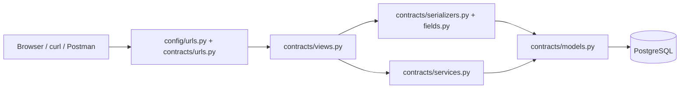

# MNK contract engine service

A Python, Django and Django REST Framework API backed by PostgreSQL. It stores an original contract slip and separate endorsements, then calculates the as-amended position for today or a requested date. Endorsements never overwrite the original slip.

## Getting started

Start PostgreSQL, then Django, then the React frontend. Both application folders are siblings in the challenge workspace. This README covers backend setup and API verification; the [frontend README](../mnk-contract-engine-frontend/README.md) covers browser setup and a complete manual test sequence. No seed data or login is required: create your first contract through the API below or through the frontend.

| Component      | Local address           | How it runs                |
| -------------- | ----------------------- | -------------------------- |
| PostgreSQL 16  | `127.0.0.1:5433`        | Docker Compose             |
| Django API     | `http://127.0.0.1:8000` | Python virtual environment |
| React frontend | `http://127.0.0.1:5173` | Node.js / Vite             |

## Contents

- [Local setup](#local-setup)
- [Design and implementation](#design-and-implementation)
- [API reference](#api-reference)
- [End-to-end walkthrough](#end-to-end-walkthrough)
- [Other endorsement types](#other-endorsement-types)
- [Business rules and scenarios](#business-rules-and-scenarios)
- [Testing](#testing)
- [Database operations and troubleshooting](#database-operations-and-troubleshooting)
- [Current limitations](#current-limitations)

## Local setup

### 1. Prerequisites

Install Python 3.10 or newer (Django 5.2 requires at least Python 3.10), Docker with Docker Compose v2, and curl or Postman. Start the Docker engine before running Compose. From the challenge workspace, enter the service folder first:

```bash
cd mnk-contract-engine-service
python3 --version
docker --version
docker compose version
```

Run all remaining backend commands from this folder, where `manage.py` and `compose.yml` are located. On Windows use `py --version` to check Python.

### 2. Create a virtual environment and install dependencies

On macOS/Linux:

```bash
python3 -m venv .venv
source .venv/bin/activate
python -m pip install -r requirements.txt
```

On Windows PowerShell, create the environment with `py -m venv .venv` and activate it with `.venv\Scripts\Activate.ps1`, then run the same pip command.

Dependencies are pinned in `requirements.txt`: Django, Django REST Framework, django-cors-headers, psycopg with its binary package, python-dotenv, and supporting packages.

### 3. Configure the environment

Create a file named `.env` in the repository root. There is currently no `.env.example` in this checkout. Use these values, replacing the example password and secret key:

```dotenv
DB_NAME=contract_engine
DB_USER=contract_app
DB_PASSWORD=replace-with-a-local-password
DB_HOST=127.0.0.1
DB_PORT=5433
SECRET_KEY=replace-with-a-long-random-secret
DEBUG=True
```

Do not commit `.env`; it is ignored by `.gitignore`. Django loads it using python-dotenv. Exported environment variables take precedence over `.env`. All five `DB_*` variables are required by Django settings; Compose defaults alone do not configure Django.

| Setting       | Purpose                                                      |
| ------------- | ------------------------------------------------------------ |
| `DB_NAME`     | PostgreSQL database name                                     |
| `DB_USER`     | Database role used by the application                        |
| `DB_PASSWORD` | Database password; required by Compose                       |
| `DB_HOST`     | Host accessed by Django running on your machine              |
| `DB_PORT`     | Host port published by Compose, `5433`                       |
| `SECRET_KEY`  | Django secret; settings otherwise use a development fallback |
| `DEBUG`       | Enabled only when the value is exactly `True`                |

### 4. Start PostgreSQL

```bash
docker compose up -d --wait db
docker compose ps
```

Compose runs `postgres:16-alpine`, exposes container port `5432` as `127.0.0.1:5433`, and persists the database in the `postgres_data` named volume. Its health check uses `pg_isready`. Only PostgreSQL runs in Docker; Django runs in the virtual environment on your host.

### 5. Apply migrations

```bash
python manage.py migrate
python manage.py showmigrations contracts
python manage.py check
```

Migration `0001_initial` creates contracts. Migration `0002_endorsement` creates endorsements and their uniqueness constraint. Do not run `makemigrations` for initial setup: the migrations are already included.

### 6. Start the application

```bash
python manage.py runserver 127.0.0.1:8000
```

There is no separate backend compilation/build step: installing the pinned dependencies and applying the committed migrations prepares the service to run. `manage.py check` verifies Django configuration.

Keep this terminal open. Use another terminal for curl commands. If you run management commands there, activate the same virtual environment first.

### 7. Verify connectivity

```bash
curl -i "http://127.0.0.1:8000/health/"
```

A working database returns HTTP 200:

```json
{
  "status": "ok",
  "application": "mnk-contract-engine-service",
  "version": "1.0.0",
  "database": "postgresql"
}
```

A database connection failure returns HTTP 503 with `status: "error"`. The health endpoint executes `SELECT 1`; it checks connectivity, not whether application migrations have been applied.

### 8. Start the frontend and review end to end

In a second terminal, from the challenge workspace:

```bash
cd mnk-contract-engine-frontend
npm ci
npm run dev -- --host 127.0.0.1 --port 5173 --strictPort
```

Use Node.js 22.13+ within the 22.x series, or Node.js 24.x, with npm installed. Open `http://127.0.0.1:5173`. Vite forwards `/api` and `/health` to Django on port 8000. Keep Docker, Django and Vite running throughout the review. Follow the [frontend setup and manual scenarios](../mnk-contract-engine-frontend/README.md) for environment configuration, build commands, sample inputs and expected browser results.

## Design and implementation



| File                                                                                  | Responsibility                                                                        |
| ------------------------------------------------------------------------------------- | ------------------------------------------------------------------------------------- |
| `config/settings.py`                                                                  | Environment loading, PostgreSQL connection, UTC timezone, DRF and CORS configuration  |
| `config/urls.py`                                                                      | Mount `/health/` and `/api/`                                                          |
| `contracts/urls.py`                                                                   | Contract, endorsement and position routes                                             |
| `contracts/views.py`                                                                  | HTTP methods, responses, object lookup, transaction and contract row locking          |
| `contracts/serializers.py`                                                            | Request/response fields and model-level serialization                                 |
| `contracts/fields.py`                                                                 | Half-up decimal rounding and rejection of floating-point endorsement amounts          |
| `contracts/services.py`                                                               | Position calculation, endorsement validation, premium checks and cancellation refunds |
| `contracts/models.py`                                                                 | Persistent contract and endorsement schema                                            |
| `contracts/migrations/`                                                               | Versioned database schema                                                             |
| `contracts/tests.py`, `test_endorsements.py`, `test_positions.py`, `test_services.py` | API and calculation tests                                                             |
| `compose.yml`                                                                         | Local PostgreSQL container, health check and persistent volume                        |

### Data model

A `Contract` stores a unique `mga_reference`, insured name, class of business, inception and expiry dates, currency, sum insured, gross premium, brokerage percentage and signed line percentage. Database ID, `status` and `created_at` are read-only API fields. New slips have status `BOUND`.

An `Endorsement` belongs to a contract and stores its number, type, status, effective date, recorded date, premium change, JSON changes and reason. The API obtains the contract from the URL; clients do not supply its database ID. A protected foreign key prevents ORM deletion of a contract with endorsements. `(contract, endorsement_number)` is unique in the database, and endorsements are ordered by number.

Money columns use `DecimalField(max_digits=18, decimal_places=2)`; percentages use `max_digits=5, decimal_places=2`. Monetary responses are decimal strings. Endorsement `changes` are validated and normalized before storage.

### Write and read paths

Contract creation validates a `ContractSerializer` and inserts the original slip. Endorsement creation runs inside `transaction.atomic()`, locks the parent contract with `select_for_update()`, validates the serializer and business rules, then inserts the endorsement. This serializes endorsement requests for the same contract and keeps validation and persistence in one transaction.

Position reads start with the slip, select eligible agreed endorsements, and replay them in endorsement-number order. They calculate a response without saving a new position or modifying the slip. Detail reads return the original slip, all endorsements, and today's calculated position.

## API reference

Local base URL: `http://127.0.0.1:8000`. Include the trailing slash in every endpoint. POST requests use `Content-Type: application/json`; GET requests need no body. No authentication is currently enforced by these views.

| Method | Path                                                        | Successful response                               |
| ------ | ----------------------------------------------------------- | ------------------------------------------------- |
| GET    | `/health/`                                                  | 200, application and database status              |
| POST   | `/api/contracts/`                                           | 201, created original slip                        |
| GET    | `/api/contracts/`                                           | 200, array of original slips ordered by reference |
| GET    | `/api/contracts/{mga_reference}/`                           | 200, `slip`, `endorsements`, `current_position`   |
| POST   | `/api/contracts/{mga_reference}/endorsements/`              | 201, created endorsement                          |
| GET    | `/api/contracts/{mga_reference}/position/?as_at=YYYY-MM-DD` | 200, position directly                            |

The list endpoint currently returns an unpaginated array even though global DRF pagination settings exist. It lists original slips, including their original `BOUND` status, rather than calculated current positions.

`as_at` is optional. Omitting it uses `timezone.localdate()` in Django's configured timezone, currently UTC. Supplied values must be valid calendar dates in exactly `YYYY-MM-DD` form. A future date is accepted.

## End-to-end walkthrough

These examples use `MNK-COMPANY-2026-001`. If this contract or endorsement already exists, skip its POST step and use GET to inspect it, or choose a new contract reference consistently throughout the examples. Duplicate creates return 400.

### 1. Create the original slip

```bash
curl -i -X POST "http://127.0.0.1:8000/api/contracts/" \
  -H "Content-Type: application/json" \
  --data '{
    "mga_reference": "MNK-COMPANY-2026-001",
    "insured_name": "Raman Logistics Ltd",
    "class_of_business": "Property",
    "inception_date": "2026-10-10",
    "expiry_date": "2026-12-31",
    "currency": "INR",
    "sum_insured": "5000000.00",
    "gross_premium": "120000.00",
    "brokerage_pct": "20.00",
    "signed_line_pct": "25.00"
  }'
```

Expected: HTTP 201 with these fields plus a generated `id`, `status: "BOUND"` and `created_at`. All fields shown in the request are required.

### 2. List contracts and verify the reference

```bash
curl "http://127.0.0.1:8000/api/contracts/"
```

Copy the exact `mga_reference` into subsequent URLs. Use `MNK-COMPANY-2026-001`, not the database ID `1` or a different sample reference such as `MNK-PR-2026-001`.

### 3. Add an agreed sum-insured change

```bash
curl -i -X POST "http://127.0.0.1:8000/api/contracts/MNK-COMPANY-2026-001/endorsements/" \
  -H "Content-Type: application/json" \
  --data '{
    "endorsement_number": 1,
    "type": "CHANGE_SUM_INSURED",
    "status": "AGREED",
    "effective_date": "2026-11-10",
    "recorded_date": "2027-02-14",
    "premium_change": "20000.00",
    "changes": {"sum_insured": "6000000.00"},
    "reason": "Sum insured increased for new warehouse"
  }'
```

Expected: HTTP 201. The original slip remains at sum insured `5000000.00` and gross premium `120000.00`. The later recorded date is retained for audit and does not delay the endorsement's effect.

### 4. Inspect the full contract

```bash
curl "http://127.0.0.1:8000/api/contracts/MNK-COMPANY-2026-001/"
```

The response has three top-level fields: `slip` is the original record, `endorsements` includes agreed, draft and future entries, and `current_position` is calculated for today's UTC date. Before November 10, endorsement 1 is visible in the history but absent from the current position.

### 5. Query before the effective date

```bash
curl "http://127.0.0.1:8000/api/contracts/MNK-COMPANY-2026-001/position/?as_at=2026-11-09"
```

Expected: `applied_endorsements: []`, sum insured `5000000.00`, gross premium `120000.00`, net premium `96000.00`, and our net premium `24000.00`.

### 6. Query on the effective date

```bash
curl "http://127.0.0.1:8000/api/contracts/MNK-COMPANY-2026-001/position/?as_at=2026-11-10"
```

Expected complete position:

```json
{
  "mga_reference": "MNK-COMPANY-2026-001",
  "as_at": "2026-11-10",
  "insured_name": "Raman Logistics Ltd",
  "status": "BOUND",
  "inception_date": "2026-10-10",
  "expiry_date": "2026-12-31",
  "cancellation_effective_date": null,
  "currency": "INR",
  "sum_insured": "6000000.00",
  "applied_endorsements": [1],
  "gross_premium": "140000.00",
  "net_premium": "112000.00",
  "our_net_premium": "28000.00"
}
```

### 7. Query today's position

```bash
curl "http://127.0.0.1:8000/api/contracts/MNK-COMPANY-2026-001/position/"
```

This matches `current_position` from the detail endpoint when both requests use the same UTC date.

### Postman and browser usage

In Postman, select GET, paste the complete position URL and send it. Alternatively, enter the URL without its query string and add a Params entry with key `as_at` and value `2026-11-10`. Leave the body empty. For POST, select Body → raw → JSON and paste the payload from the corresponding example. GET URLs also work directly in a browser; responses are JSON, with no DRF browsable interface configured.

## Other endorsement types

Every endorsement request uses the same POST URL and requires a positive, unused `endorsement_number`, `type`, `status`, `effective_date`, `recorded_date`, `premium_change` and nonblank `reason`. Send `changes` explicitly; it defaults to `{}` if omitted, which is valid only for the two types requiring an empty object.

| Type                 | Exact `changes` shape                           | Position effect                        |
| -------------------- | ----------------------------------------------- | -------------------------------------- |
| `CHANGE_SUM_INSURED` | `{"sum_insured": "6000000.00"}`                 | Replace sum insured                    |
| `CHANGE_DETAILS`     | `{"insured_name": "Raman Logistics Group Ltd"}` | Replace insured name                   |
| `PREMIUM_ADJUSTMENT` | `{}`                                            | Change gross premium only              |
| `EXTENSION`          | `{"expiry_date": "2027-06-30"}`                 | Replace expiry with a later date       |
| `CANCELLATION`       | `{}`                                            | Cancel and end cover the preceding day |

All eligible endorsements also add their `premium_change` to gross premium. The following are alternative examples after walkthrough endorsement 1. To try them all on one contract, allocate distinct numbers and ensure their effective dates and any cancellation satisfy the rules below.

### Change insured name

```json
{
  "endorsement_number": 2,
  "type": "CHANGE_DETAILS",
  "status": "AGREED",
  "effective_date": "2026-11-15",
  "recorded_date": "2026-11-16",
  "premium_change": "0.00",
  "changes": { "insured_name": "Raman Logistics Group Ltd" },
  "reason": "Updated company name"
}
```

### Draft premium adjustment

```json
{
  "endorsement_number": 2,
  "type": "PREMIUM_ADJUSTMENT",
  "status": "DRAFT",
  "effective_date": "2026-11-15",
  "recorded_date": "2026-11-16",
  "premium_change": "5000.00",
  "changes": {},
  "reason": "Proposed additional premium"
}
```

Drafts appear in detail history but do not affect positions. There is currently no endpoint to promote a stored draft to agreed.

### Extend cover

```json
{
  "endorsement_number": 2,
  "type": "EXTENSION",
  "status": "AGREED",
  "effective_date": "2026-12-01",
  "recorded_date": "2026-12-02",
  "premium_change": "10000.00",
  "changes": { "expiry_date": "2027-06-30" },
  "reason": "Extend policy period"
}
```

Once this agreed extension is effective, it permits later endorsements within the extended period. A draft extension does not extend cover.

### Cancel cover

Use this after endorsement 1 alone, or after earlier agreed changes whose dates precede the cancellation:

```json
{
  "endorsement_number": 2,
  "type": "CANCELLATION",
  "status": "AGREED",
  "effective_date": "2026-12-01",
  "recorded_date": "2026-12-02",
  "premium_change": null,
  "changes": {},
  "reason": "Insured requested cancellation"
}
```

For the walkthrough contract with endorsement 1 alone, the total period is 83 days and the unused period is 31 days. The service stores a refund of `-52289.16`. On December 1 the calculated position has status `CANCELLED`, expiry `2026-11-30`, gross premium `87710.84`, net premium `70168.67`, and our net premium `17542.17`. The original slip stays `BOUND` with its original expiry.

## Business rules and scenarios

### Position selection and ordering

| Scenario                                | Implemented behavior                                                               |
| --------------------------------------- | ---------------------------------------------------------------------------------- |
| Date before inception                   | Return original values, no applied endorsements, status `BOUND`                    |
| Date before an endorsement takes effect | Exclude that endorsement                                                           |
| Date equals effective date              | Include the agreed endorsement; the boundary is inclusive                          |
| Draft endorsement                       | Never included in a position                                                       |
| Future agreed endorsement               | Listed in detail; included only when the requested date reaches its effective date |
| Recorded date after the requested date  | Does not exclude an otherwise eligible endorsement                                 |
| Multiple eligible endorsements          | Apply in ascending endorsement-number order, not effective-date order              |
| Multiple changes to the same field      | Last eligible change in number order wins                                          |
| Date after ordinary expiry              | Status remains `BOUND`; expiry alone does not introduce an expired status          |
| Date on/after agreed cancellation       | Status `CANCELLED`; expiry becomes cancellation date minus one day                 |
| No agreed cancellation                  | `cancellation_effective_date` is JSON `null`                                       |
| GET original slip list after amendments | Original values remain unchanged                                                   |

This is an effective-date position, not a reconstruction of what was known on the requested date: recorded dates do not filter history.

### Endorsement validation

| Scenario                                                       | Result                                                                       |
| -------------------------------------------------------------- | ---------------------------------------------------------------------------- |
| Positive unused number                                         | Accepted; gaps and out-of-sequence insertion are allowed                     |
| Duplicate number, including one used by a draft                | 400, `endorsement_number` error                                              |
| Zero/negative number or unknown type/status                    | 400, corresponding field error                                               |
| Missing required field or blank reason                         | 400, serializer error                                                        |
| Effective date outside inception through current agreed expiry | 400, `effective_date` error                                                  |
| Effective date on/after an existing agreed cancellation        | 400, `effective_date` error, including for new drafts                        |
| Wrong, missing or extra keys in `changes`                      | 400, `changes` error                                                         |
| `changes` is not a JSON object                                 | 400, `changes` error                                                         |
| Negative or invalid changed sum insured                        | 400, nested `changes.sum_insured` error                                      |
| Extension date equal to or earlier than current expiry         | 400, nested `changes.expiry_date` error                                      |
| Extension with malformed expiry                                | 400, date error                                                              |
| Non-cancellation `premium_change: null`                        | 400, `premium_change` error                                                  |
| Cancellation `premium_change: null`                            | Accepted and replaced by computed refund                                     |
| Valid supplied cancellation amount                             | Replaced by computed refund; invalid input still fails serializer validation |
| Endorsement decimal string with extra decimal places           | Rounded half up before precision and balance checks                          |
| Endorsement monetary float, NaN, Infinity or oversized amount  | 400                                                                          |

Drafts must satisfy field, change and effective-date rules. Their premium changes do not undergo agreed-balance checks and cannot fund agreed returns. A draft cancellation receives a calculated estimate and passes cancellation conflict checks, but does not cancel the position.

### Premium calculation

```text
gross premium = original gross premium + eligible agreed premium changes
net premium = round_half_up(gross premium × (1 − brokerage_pct / 100), 2)
our net premium = round_half_up(rounded net premium × signed_line_pct / 100, 2)
```

Gross premium is rounded to two places first. Each following stage uses the rounded preceding result. For example, `140000.00` gross with 20% brokerage and a 25% signed line produces `112000.00` net and `28000.00` our net.

Agreed endorsement validation checks every effective-date position and every intermediate balance in number order. A return may reduce gross premium exactly to zero, but cannot make it negative. A draft increase or future increase cannot fund an earlier agreed return. A positive final balance cannot hide a negative intermediate balance.

### Cancellation calculation and conflicts

```text
current expiry = expiry after agreed extensions effective by cancellation date
current gross = original gross + agreed non-cancellation changes effective by that date
total days = (current expiry − inception date) + 1
unused days = (current expiry − cancellation effective date) + 1
premium change = round_half_up(−current gross × unused days / total days, 2)
```

Both day counts are inclusive. Cancellation at inception refunds the entire applicable gross premium; cancellation on expiry refunds one day. Eligible extensions affect both the cover period and gross premium used for the refund. Drafts and future changes are excluded.

A cancellation is rejected if any existing agreed endorsement takes effect on or after its date. A subsequent agreed backdated change is rejected if recalculation would change a stored agreed cancellation refund. A zero-premium backdated details change can be accepted when it leaves the refund unchanged. Stored refunds are never silently rewritten.

### HTTP errors

| Request/problem                                                                            | Status and response                                       |
| ------------------------------------------------------------------------------------------ | --------------------------------------------------------- |
| Unknown reference in detail or position GET                                                | 404, `{"detail": "No Contract matches the given query."}` |
| Unknown reference in endorsement POST                                                      | 400, error keyed by `mga_reference`                       |
| Duplicate contract reference                                                               | 400, error keyed by `mga_reference`                       |
| Invalid `as_at`, including empty value, `2026-02-30`, `2026-2-1`, compact date or datetime | 400, error keyed by `as_at`                               |
| Unsupported method, such as POST to position                                               | 405                                                       |
| Database unavailable during health check                                                   | 503                                                       |

An unknown contract is looked up before `as_at` validation, so an unknown reference still returns 404 even if its date query is invalid. Validation responses generally contain field names mapped to arrays of messages or nested errors.

## Testing

With the virtual environment activated and PostgreSQL healthy:

```bash
python manage.py check
python manage.py test contracts
```

To run a focused suite:

```bash
python manage.py test contracts.test_positions
python manage.py test contracts.test_endorsements
python manage.py test contracts.test_services
python manage.py test contracts.tests
```

Django creates a separate test database (normally `test_contract_engine`) and removes it afterward. The database role must have permission to create databases; the role initialized by this local PostgreSQL image has that capability. A manually provisioned restricted role may need `CREATEDB` or a separately prepared test database.

The tests cover creation and listing, required fields and uniqueness, health success/failure, slip preservation, all endorsement types, draft exclusion, effective and recorded dates, number ordering, extensions, cancellation and backdated conflicts, nonnegative intermediate balances, decimal rounding, invalid amounts, position date validation, unknown references and method restrictions. Tests patch today's date where necessary so results do not depend on the day they run.

### Reviewer verification checklist

1. Run `/health/` and confirm HTTP 200 with `database: "postgresql"`.
2. Complete the API walkthrough using an unused reference; confirm HTTP 201 on both POST requests.
3. Compare November 9 and November 10 positions against the exact figures above.
4. Confirm the detail response retains the original slip alongside endorsement history.
5. Run `python manage.py test contracts --verbosity 2`; expect all discovered tests to pass. The focused suites above identify the code covering each rule.
6. Complete the frontend manual sequence for all five endorsement types, drafts, historical dates, cancellation and validation failures.

## Database operations and troubleshooting

### Inspect PostgreSQL

```bash
docker compose logs --tail=100 db
docker compose exec db sh -c 'psql -U "$POSTGRES_USER" -d "$POSTGRES_DB"'
```

Inside psql:

```sql
\dt
SELECT id, mga_reference, status, gross_premium FROM contracts_contract;
SELECT contract_id, endorsement_number, type, status, effective_date, premium_change
FROM contracts_endorsement ORDER BY contract_id, endorsement_number;
\q
```

Read-only queries help inspect data; direct database writes bypass API business validation.

### Stop and restart

Stop Django with Ctrl+C. Stop containers while retaining database data:

```bash
docker compose down
```

Restart PostgreSQL with `docker compose up -d --wait db` and Django with `python manage.py runserver`. The named volume retains contracts and endorsements.

### Common problems

| Symptom                                                    | Check/action                                                                                                                                                                                                                                                                                                            |
| ---------------------------------------------------------- | ----------------------------------------------------------------------------------------------------------------------------------------------------------------------------------------------------------------------------------------------------------------------------------------------------------------------- |
| Missing `DB_NAME` or another `DB_*` at startup             | Create `.env` at the repository root with all five database variables                                                                                                                                                                                                                                                   |
| Docker daemon unavailable                                  | Start Docker and rerun Compose                                                                                                                                                                                                                                                                                          |
| Port 5433 already in use                                   | Free the port or change the Compose host port and `DB_PORT` together                                                                                                                                                                                                                                                    |
| Connection refused / health 503                            | Check `docker compose ps`, logs, host `127.0.0.1` and port `5433`                                                                                                                                                                                                                                                       |
| Password authentication failed after changing `.env`       | Existing volume credentials are unchanged; restore the original credentials or deliberately update the PostgreSQL role password                                                                                                                                                                                         |
| Tables do not exist                                        | Run `python manage.py migrate` against the same database used by the server                                                                                                                                                                                                                                             |
| Contract not found                                         | List `/api/contracts/`, copy the exact reference and use the same running server/database                                                                                                                                                                                                                               |
| Frontend `/api/contracts/?page=1` returns 502 on port 5173 | The Vite proxy targets `http://127.0.0.1:8000`. Start Django with `python manage.py runserver 127.0.0.1:8000` and keep it running alongside Vite. Verify `/health/` directly on port 8000, then retry the frontend request. The current list endpoint ignores `page` and returns an array, which the frontend supports. |
| Duplicate reference/number                                 | Skip the existing create or choose a new unused reference/number                                                                                                                                                                                                                                                        |
| Endorsement appears in history but not position            | Check `status`, `effective_date` and requested `as_at`                                                                                                                                                                                                                                                                  |
| Date around midnight differs from your local date          | Today uses UTC, not the client machine's timezone                                                                                                                                                                                                                                                                       |
| Tests cannot create the test database                      | Check database role permissions                                                                                                                                                                                                                                                                                         |
| Browser frontend blocked by CORS                           | Configured origins are `http://localhost:5173` and `http://127.0.0.1:5173`                                                                                                                                                                                                                                              |

PostgreSQL initializes its database name, user and password only when the data volume is first created. Editing `.env` does not update existing database credentials. Avoid deleting the volume to troubleshoot valuable data. `docker compose down -v` deletes the project volumes and all stored database records; use it only for an intentional reset of disposable local data, then restart PostgreSQL and rerun migrations. Existing SQLite records are not automatically imported into PostgreSQL.

## Current limitations

- No authentication or application-specific authorization is configured for these API endpoints.
- Contract and endorsement update/delete endpoints and draft promotion are not implemented.
- Contract creation uses standard model serializer validation. It does not add business checks for inception/expiry ordering, nonnegative original monetary values, percentage ranges of 0–100, or recognized currency codes. The custom half-up/float rejection behavior applies to endorsements, not original slip creation.
- The list endpoint returns original slips without pagination or current positions; position responses omit some original fields such as class of business and the percentages.
- No expired status is calculated. A pre-inception position still reports the original `BOUND` slip.
- The health endpoint checks database connectivity only; ordinary API database failures are not converted to its 503 response format.
- This setup uses Django's development server, local allowed hosts, UTC and two development CORS origins. Production deployment, TLS, credential management, access controls, backups and monitoring need separate configuration.
